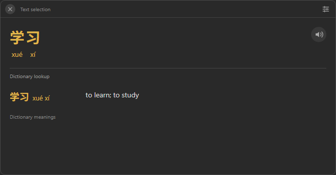

# Hanzi Lens for Windows

Highlight Chinese text in a Windows app and press **Ctrl+Shift+D** to see pinyin and English definitions beside the selection. For text inside an image or video, press **Ctrl+Shift+S** and drag over the characters. An optional language pack translates whole sentences on your CPU.



## Try it

1. Open the [Windows desktop builds](https://github.com/Web1000/Translate/actions/workflows/windows.yml) and choose a successful run for `main`.
2. Download **Hanzi-Lens-Windows-x64** from its artifacts, extract the ZIP, and launch the portable executable. GitHub may ask you to sign in.
3. Highlight **学习** and press **Ctrl+Shift+D**. Dictionary lookup works offline. For sentence translation, open **Settings → Translation → Download language pack** once.

## How it works

The Electron tray app reads selected text through Windows UI Automation, with a clipboard fallback. Screen-region lookup uses local Tesseract OCR. CC-CEDICT supplies word readings and definitions. Longer passages can use quantized OPUS-MT in a separate process, keeping translation work off the UI thread.

I compared three offline engines on 54 diagnostic cases, checking meaning, latency, and memory use. The larger alternatives still reversed negation or dropped clauses in some cases, so I kept OPUS-MT and routed recognized single words directly to the dictionary. [Model comparison and examples](docs/translation-quality.md)

## Run from source

On Windows with Node.js 22.12+ installed, run these commands in PowerShell from the repository root:

```powershell
npm.cmd ci
npm.cmd run setup:electron
npm.cmd run assets
npm.cmd start
```

Run `npm.cmd test` for the unit suite. The Windows build workflow also exercises OCR, UI behavior, real offline translation, the packaged app, and native text selection before uploading the executable.

[Windows setup, privacy, and troubleshooting](docs/windows-guide.md) · [Architecture](docs/app-explained.md) · [Validation results](VALIDATION.md) · [Data and model credits](resources/NOTICE.md)
