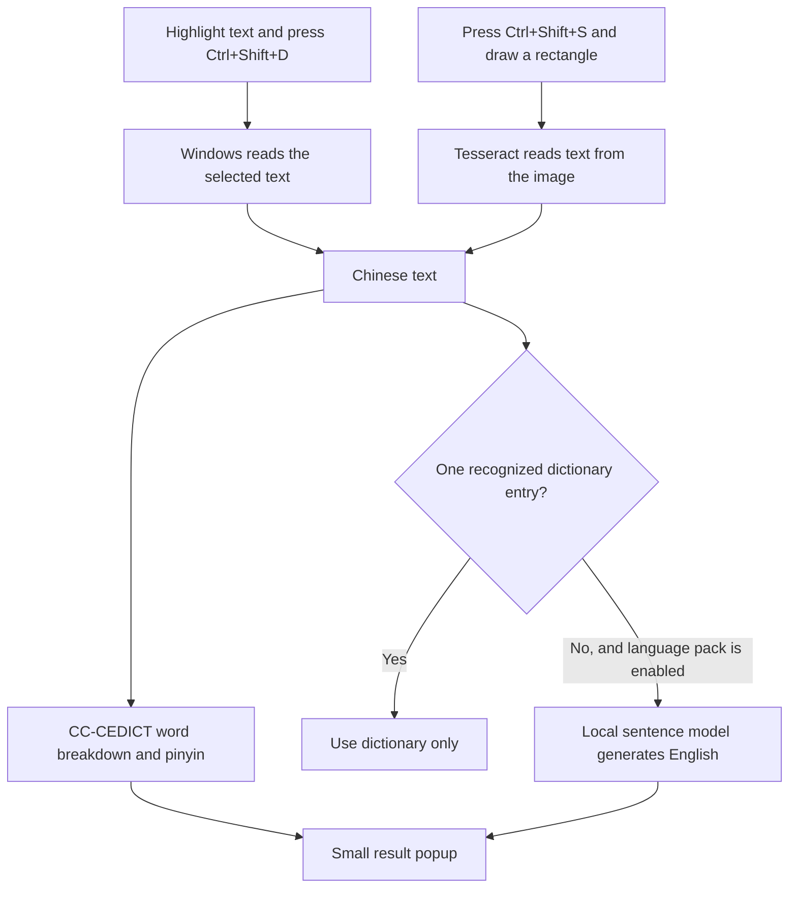

# Hanzi Lens, explained from the beginning

This guide describes version **0.3.0-beta.3**, checked against the code at commit `c98acaa`. It explains the existing app, including its limitations. It does not promise that every translation is correct.

## 1. What you are building

Hanzi Lens is a Windows app that helps someone read Chinese in other apps. It is inspired by HanZiKey for Mac, but is an independent project. Its main jobs are:

1. Read Chinese text that you highlight, using **Ctrl+Shift+D**.
2. Read Chinese inside an image or video, using **Ctrl+Shift+S** and a rectangle you draw.
3. Show a small popup with pronunciation, dictionary meanings, and, for longer input, an optional generated English translation.

The main window is for settings. It has no translation typing box. You can close Settings and keep using the shortcuts. To stop the app completely, choose **Quit Hanzi Lens** from the small icon in the Windows system tray, usually near the clock. Closing Settings hides that window; it does not quit the program.

## 2. Three different jobs happen behind the popup

The app must obtain text, look up words, and sometimes translate a passage. These jobs use different tools.

| Job | Example | Tool in this app |
| --- | --- | --- |
| Read an existing text selection | Get the highlighted characters 银行 from a browser | Windows accessibility, or a temporary copy operation |
| Read letters from a picture | Recognize 银行 in a screenshot | Tesseract OCR |
| Look up words and pronunciation | Find that 银行 means bank and is pronounced yín háng | CC-CEDICT |
| Translate a whole sentence | Turn 我喜欢学习中文。 into “I like learning Chinese.” | The OPUS-MT translation model |

**OCR does not translate. The dictionary is not the sentence translator.** A problem in one stage can affect the stages after it.



## 3. What Ctrl+Shift+D does

Suppose you highlight **交际** in another program.

Windows first tells Hanzi Lens which app and text control currently have focus. Focus means the place receiving your keyboard input. The app asks Windows accessibility for the selected text. Accessibility is an interface that also helps tools such as screen readers inspect text and controls.

If that does not work, a small helper presses the equivalent of **Ctrl+C**. It waits for the copied text to appear on the clipboard. The clipboard is the temporary storage you use when copying and pasting.

The app backs up supported clipboard content before doing this. When the copy fallback succeeds and the clipboard still contains that copied selection, it tries to restore the previous content. It avoids overwriting a newer copy you made in the meantime. Unusual clipboard formats specific to another application may not survive this operation.

Only after reading the text does the app show its popup. Opening Settings first would steal focus from the app whose selection we need. That is why the shortcut must not open the entire settings window.

This depends on the other program cooperating with accessibility or copying. Some elevated programs, protected content, games, or unusual controls may block it. Screen capture provides another way to get the text.

## 4. What Ctrl+Shift+S does

An image contains colored pixels, not necessarily selectable characters. Hanzi Lens needs OCR: **optical character recognition**, meaning software that identifies written characters in a picture.

The app temporarily captures the monitor containing your mouse pointer. It hides its own Settings and popup first so they do not obstruct the image. It displays the captured image in a selection overlay. You draw a rectangle, and the app crops that rectangle for recognition.

Tesseract reads the cropped image using its Simplified and Traditional Chinese recognition files. Its output is ordinary text, which then enters the same dictionary/translation path as highlighted text.

The application does not write screenshot files as part of this flow or upload them for recognition. Images are handled in memory. That is not a claim of secure memory erasure or a guarantee about how Windows manages memory.

Small text, blur, fancy fonts, busy backgrounds, vertical layouts, or protected video can cause recognition errors. If the image says 银行 but OCR reads different characters, even a good translator receives the wrong input. Drawing a smaller, clearer capture area can help. Press **Esc** to cancel the overlay.

## 5. What CC-CEDICT contributes

CC-CEDICT is a community Chinese–English dictionary. A typical record contains:

- Traditional characters, such as 銀行.
- Simplified characters, such as 银行.
- Pinyin, such as `yin2 hang2`.
- English definitions, such as bank, meaning a financial institution.

Pinyin writes Mandarin pronunciation using the Latin alphabet. Tone numbers in the stored data are displayed as marks: `yin2` becomes **yín**. The colored characters also indicate the dictionary tones. These are dictionary readings, not a complete analysis of pronunciation changes in connected speech.

The dictionary is included with the app, so looking up its records does not require a server or a paid key. The app uses a packaged JSON version called `cedict-json`. JSON is simply a structured text format that software can read.

### Why Chinese must be split into words

Chinese usually does not put spaces between words. The app therefore has to decide which characters belong together. This is called **word segmentation**.

For a sentence such as 我喜欢学习中文, a useful breakdown is 我 / 喜欢 / 学习 / 中文. The app currently searches for the longest dictionary entry matching the beginning of the remaining text, takes that match, and repeats. This is a practical rule, not a human-level understanding of the sentence.

Different segmentation can produce different meanings even when two apps use the same dictionary.

### Why a dictionary word can have several meanings

One written word can have multiple readings or English senses. The dictionary lists possibilities; it does not automatically know which one a speaker intended in your particular sentence.

The app merges duplicate records and shows one main row for each recognized word occurrence. Other readings are expandable. Ordinary definitions are generally placed ahead of surname or variant references. This helps avoid showing a surname for 全 when the ordinary meaning is intended.

That ordering is still a rule of thumb. It is not a contextual language model. It can pick the wrong reading, including the wrong tone for a character such as 看.

If a word genuinely occurs twice in your input, it can legitimately appear twice in the breakdown. The duplicate fix prevents separate main rows just because a single occurrence has several dictionary entries.

Standalone English letters such as APP are excluded from dictionary matching and the reading strip. They are retained in the original input supplied to the sentence translator. Ignoring APP in the word list does not mean deleting it from the translation input.

## 6. Why whole sentences need something different

Looking up four words does not tell the app how to express their combined meaning in natural English. Chinese and English arrange information differently. Pronouns, idioms, implied subjects, and negation also need interpretation.

The app uses a **pretrained translation model** for this job. Other people previously trained the model on language data. We download the finished model; the app does not train it on your computer or learn automatically from your lookups.

The current model is OPUS-MT Chinese to English. More precisely, it uses the `Xenova/opus-mt-zh-en` conversion of a Helsinki-NLP model. Its downloaded files are about **120 MB**. They are downloaded separately through Settings → Translation.

The model is stored in ONNX format, which describes the calculations and numerical values needed to run it. ONNX Runtime performs those calculations on your CPU. Transformers.js prepares the text, runs generation, and turns the output back into text.

The model uses int8 quantization: many model values use smaller numerical representations to reduce size and resource use. Smaller models are convenient, but being fast or small does not guarantee good translations.

Hugging Face hosts the downloadable model files. It is not receiving each passage as an online translation request in this app. After installation, inference—the act of running the model—uses local files.

### Why there is no paid API key

An API is an interface through which software communicates with other software. Some internet translation APIs charge for usage. Many APIs, including the Windows interfaces used here, do not.

A paid online service is not the only way to translate sentences. Our current model runs locally, without an account or per-translation fee. The former paid OpenAI option and its key controls were removed. No LibreTranslate endpoint is currently used by the app either.

### Why recognized single words skip the model

The sentence model once translated 交际 as “No, no, no.” That output was an incorrect model generation, not the CC-CEDICT definition.

Now, if the input matches one dictionary entry, with only surrounding punctuation/spacing, the app uses the dictionary alone. That can be a word or a fixed expression. It does not generate an English sentence for that lookup. Unknown text, mixed input, and selections containing multiple entries can still use passage translation.

This fixes that route to a bad word result. It does not fix the model's sentence-level weaknesses.

## 7. Simplified and Traditional Chinese

Examples include 学习 and 學習. These are different written forms of the same word.

The dictionary indexes both forms. OCR has recognition data for both. For sentence translation, OpenCC converts Traditional input to Simplified before the model sees it. Converting a writing system is different from translating Chinese into English.

Your display preference controls which dictionary forms appear in the popup. It does not retrain the model, and it does not determine which script you may select or capture. Unmatched text keeps its original form.

## 8. Why sentence translations are still wrong sometimes

The model generates a likely English sequence; it is not retrieving an approved answer for every sentence. A plausible-looking answer can omit a clause, change who did something, reverse a negation, or change a number or currency.

For example, 我不是不想去，只是今天没有时间。 means roughly “It is not that I do not want to go; I just do not have time today.” The current model produces “I don't want to go, just don't have time for this.” The difference changes the speaker's intention.

We have compared the existing engine with Argos/LibreTranslate's tested Chinese–English backend, M2M100, and a MADLAD conversion. Some individual outputs improved, but serious regressions remained. The tested replacements were not put into the app.

The [30-case comparison](translation-evaluation.md) and [54-case comparison](translation-quality.md) contain actual outputs and limitations. These were diagnostic cases, not a representative accuracy percentage. Larger models did not automatically solve the problem.

## 9. Speed, memory, and the language pack

Your CPU does the calculations. RAM is the working memory used while programs run. Disk space stores files when the app is closed.

The language-pack download size describes disk use, not total running memory. A roughly 120 MB model pack can require several hundred megabytes of working memory, plus the app's own overhead.

The app keeps the enabled model loaded and warms it with a short generation so subsequent lookups can start faster. Turning sentence translation off releases its worker process. Removing the pack also removes its downloaded files. Those are different operations.

On Windows test machines, short warmed-up translations have often taken a fraction of a second. That is not a guarantee for your PC or long input. CPU, available RAM, other running programs, and passage length matter. No universal minimum RAM or near-instant performance guarantee has been established.

The app limits sentence-translation input to 2,000 Unicode characters and breaks it into pieces of roughly 160 characters or less. Splitting reduces resource use but can lose context. Dictionary processing has a separate 10,000-JavaScript-character limit; selected-text and OCR paths cap their text at that boundary.

New lookups cancel outdated work instead of building an unlimited waiting list. Request numbers prevent an old result from replacing the new selection's result.

## 10. What the app is made of

| Term | Meaning here |
| --- | --- |
| Source code | The editable instructions that define the app's behavior |
| JavaScript | The programming language used for most of this app |
| HTML | The structure of Settings, the popup, and the capture overlay |
| CSS | Colors, spacing, type sizes, and visual layout |
| Node.js | Runs JavaScript outside a normal browser; needed for source development |
| npm | Downloads the project's JavaScript dependencies and runs named commands |
| Dependency | Another software package the app relies on, such as Tesseract.js |
| Electron | Combines Chromium's interface engine and Node.js capabilities into a desktop app |
| PowerShell | Windows scripting tool used by the selected-text helper |
| EXE | A Windows executable; the packaged app users can launch |

Electron has a main process that talks to Windows and manages app windows. The visible pages are renderer processes. A small preload bridge gives those pages a limited set of app commands rather than unrestricted access to the computer. The model runs in a separate utility process so many engine failures can be handled without closing Settings or dictionary lookup.

The speaker button is separate again: it uses the Chinese speech voices exposed by your system. It is disabled when none are available. It does not play a recording from CC-CEDICT.

## 11. Source code, GitHub, and your PC

The development workspace used in this conversation is a cloud computer. Files written there do not automatically appear on your Windows PC.

Git records versions of source files. A commit is a saved change with an identifier. A repository is the project and its recorded history. A branch is a named line of that history; `main` is the branch we use for the current shared app source. Pushing sends local commits to GitHub. Pulling brings remote changes into another checkout.

GitHub is where this repository is stored: https://github.com/Web1000/Translate . Visual Studio Code is an editor, not the app's runtime. Keeping that editor open is unnecessary.

There are two ways to run the project:

- **Packaged app:** download the successful Windows Actions artifact, extract the ZIP, and run the EXE. No separate source folder, Node.js installation, or VS Code window is needed. The sentence pack is still a separate first-time download.
- **From source:** have the project files and Node.js, install dependencies, prepare the assets, and run `npm.cmd start`. You can do that from PowerShell without opening an editor. Keep the launching terminal running; quit the old app before restarting an updated one.

Changing source on GitHub does not update an already downloaded EXE. Pulling source does not change an app process that is already running. A build, download, or restart is needed as appropriate. Publishing a Codex development environment is a separate platform action; it is not automatically a Git push or an app release.

Preferences and installed language packs are stored in Electron's app-data directory, separate from the source folder. Consequently, replacing the source folder or EXE does not by itself remove them. The exact directory is determined by Electron, not by the folder containing your download.

## 12. What the commands mean

For a Windows source checkout:

```powershell
npm.cmd ci
npm.cmd run setup:electron
npm.cmd run assets
npm.cmd start
```

`ci` installs the dependency versions recorded in `package-lock.json`. It can take time because it downloads software. `setup:electron` installs and checks the pinned desktop runtime. `assets` downloads and checks the Chinese OCR data files. `start` launches the app from the source folder.

Use Node 22 LTS, version 22.12 or newer, or Node 24. The dictionary package declares Node 22 and can warn on Node 24. `npm.cmd` avoids the PowerShell restriction that prevented the `npm.ps1` script from running on your PC. You do not need to relax your system's script policy for these commands.

Run them inside the project folder containing `package.json`. That file describes the project, dependency versions, and named commands. The repository's README has the complete setup and build instructions.

## 13. What GitHub Actions actually does

GitHub Actions follows a recipe saved in the repository. For this app, it starts a temporary Windows machine, installs the project, runs tests, builds an EXE, tests the packaged app, and uploads a downloadable artifact only after the required checks succeed.

An artifact is a file produced by a workflow. It is not the same as the source ZIP. The Windows artifact is called **Hanzi-Lens-Windows-x64**. Use a successful run for the intended source revision. GitHub artifacts can expire.

Tests check different things:

- Small logic tests check dictionary grouping, settings, cancellation, and other functions.
- Browser and Electron tests check interface behavior and app integration.
- OCR tests actually recognize a prepared Chinese image.
- Native Windows tests select Chinese in a real test control and call the Windows helper.
- Model tests execute actual local translation.

Some integration tests substitute Windows hooks or screenshots with controlled inputs. They do not prove every real browser, game, monitor layout, tray interaction, or shortcut works on every PC.

**A green workflow means its checks passed, not that all translations are accurate.** Translation quality requires reviewing real Chinese and whether the resulting English preserves its meaning. Example sentences and screenshot comparisons complement automation.

There is currently **no weekly test schedule or recurring development task**. The earlier test-only weekly schedule was removed because you wanted actual weekly improvements. A schedule that merely runs tests does not find and implement new improvements, and this cloud chat does not automatically launch future coding sessions.

## 14. What remains unfinished

The highest priority is translation accuracy while keeping the app free to use. Sentence generation still makes serious errors, and dictionary ordering is still not true contextual sense selection. Better OCR, segmentation, contextual readings, and a stronger sentence implementation can be investigated separately, with evidence for each change.

Hover lookup, automatic subtitle rescanning, automatic application updating, and autonomous weekly development are not implemented. The packaged Windows app is unsigned. Branding and any similarity to HanZiKey need review before shipping to the public; being inspired by a product does not grant rights to its logo or assets.

The dictionary, model weights, and runtime libraries also have their own licenses. CC-CEDICT's data uses CC BY-SA 4.0; the verified OPUS model source uses CC BY 4.0. These are different licenses. See [resources/NOTICE.md](../resources/NOTICE.md) for attribution.

For another AI or developer, use [the Claude handoff](claude-handoff.md). It contains the technical map, verified state, experiments, and development priorities.
